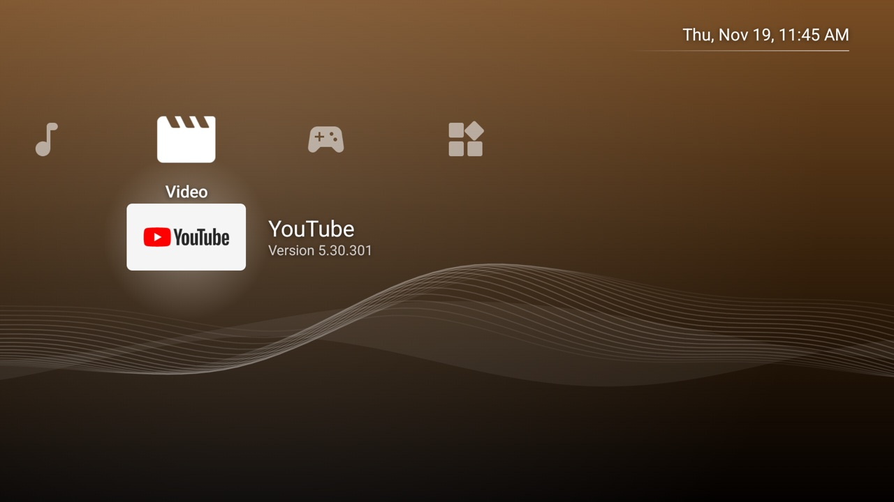
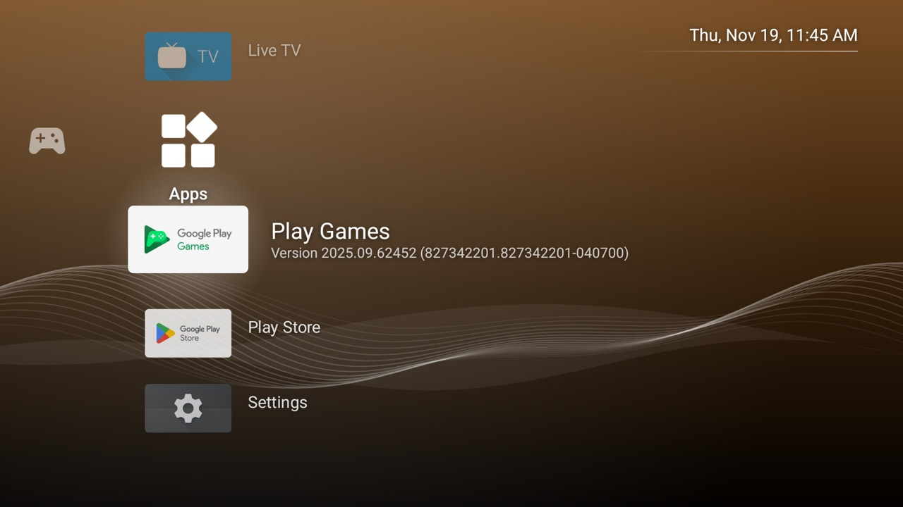
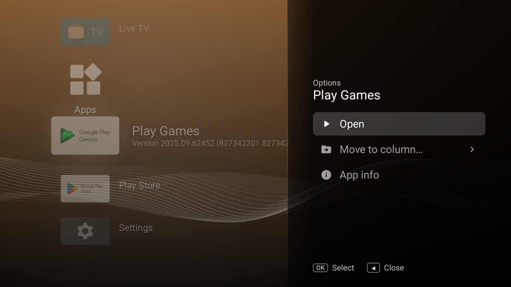
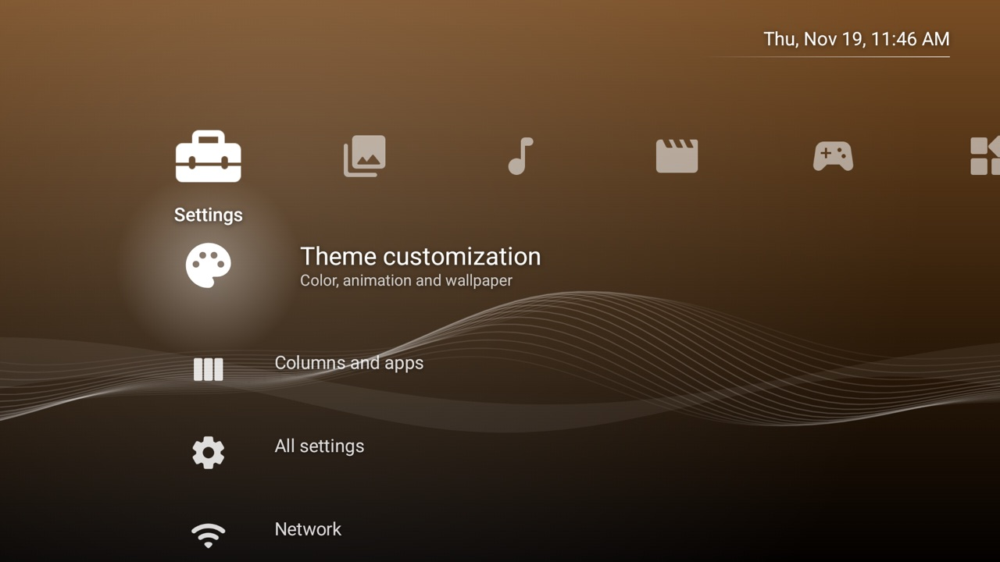
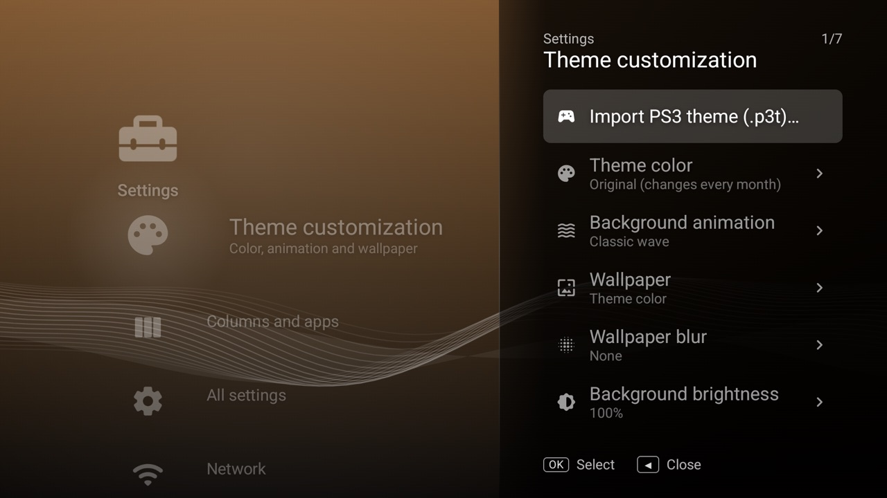
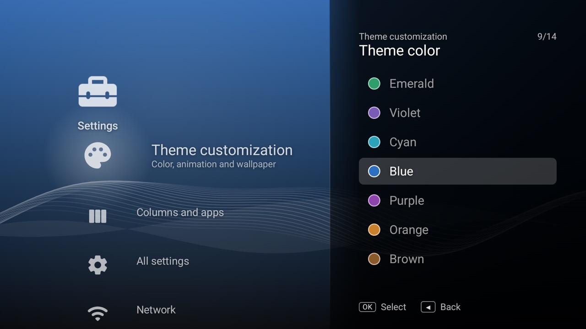

# AndroidMediaBar

A home screen for **Android TV** inspired by the cross media bar of the PlayStation 3 era:
horizontal categories, vertical lists, an animated wave background and, as a bonus, support
for **real PS3 themes (`.p3t`)**: their wallpaper and their icons.

Built entirely with Jetpack Compose, designed for the remote (D-pad) first. Runs on
**Android 10 and later**, so it covers most Android TV devices and boxes in use today.



## Screenshots

*Default look, no PS3 theme applied.*

| | |
|---|---|
|  |  |
| **Apps column**: every installed app, with its TV banner when it has one | **App options**: long-press OK to open, move to another column or inspect an app |
|  |  |
| **Settings column**: launcher menus and system shortcuts | **Theme customization**: PS3 theme import, color, animation, wallpaper… |
|  | |
| **Live preview**: the background follows the highlighted value before you confirm it | |

---

## Features

### The bar
- **Columns:** Settings, Photo, Music, Video, Games and Apps. Each installed app goes to a column
  automatically, based on its declared category and a few package-name hints.
- **Your layout:** hide the columns you don't use and move any app to the column you prefer.
- **App options:** long-press OK (or the Menu / Info key) to open, move, inspect or uninstall
  an app.
- **TV-friendly:** uses Leanback banners when available, and the bar hides behind side panels so
  the two never fight for attention.
- **Settings shortcuts:** Network, Bluetooth, Display, Sound, Date and time, Apps, Storage and
  Home screen.

### Theme customization
- **Theme color:** "Original" changes every month like the classic bar, or pick one of 13 colors.
- **Background animation:** classic wave, wave with sparkles, floating lights, still wave or none.
- **Wallpaper:** the animated theme color, your own picture, or the wallpaper of an installed PS3
  theme. Brightness is adjustable, and so is blur on Android 12 and later.
- **Day/night cycle:** the background follows the time of day.
- **Live preview:** each value is previewed while you move through the list.

### PS3 themes (`.p3t`)
Choose **Theme customization → Import PS3 theme (.p3t)…**, pick the file, and then select
**Wallpaper → PS3 theme** and **Icons → PS3 theme**. Both can be switched back at any time.

What gets imported:

| From the theme | Used for |
|---|---|
| `bgimagetable` (HD wallpaper, SD as fallback) | Wallpaper |
| `icontable` (system icons) | Column icons and Settings entries |
| `infotable` (name, author, version) | Shown in the menus |

PS3 themes name their icons with the same fixed system IDs, so the mapping works for any theme:

| Launcher | PS3 icon ID |
|---|---|
| Settings / Photo / Music / Video / Games columns | `icon_setting` / `icon_photo` / `icon_music` / `icon_video` / `icon_game` |
| Apps column | `icon_network` (the PS3 column hosting the store and browser) |
| Theme customization / Columns and apps | `icon_theme_setting` / `icon_system_setting` |
| Network, Bluetooth, Display, Sound, Date and time | `icon_network_setting`, `icon_accessory`, `icon_display_setting`, `icon_sound_setting`, `icon_datetime_setting` |
| Apps, Storage, Home screen, All settings | `icon_gamedata`, `icon_usb`, `icon_user`, `icon_setting_item` |
| Apps with neither banner nor icon | `icon_default_h` |

Every entry has fallbacks: if a theme lacks an icon, the built-in one is drawn instead. The full
mapping lives in [`Ps3Icons.kt`](app/src/main/java/com/launcher/androidmediabar/ui/xmb/Ps3Icons.kt).

> **Which files work?** Any plain `.p3t`: community themes, or the `.p3t` that a PS3 or the
> RPCS3 emulator installs from a PSN theme package you own. Retail PSN `.pkg` files are encrypted
> and are intentionally **not** supported: install them with their license first.

---

## Getting started

### Requirements
|Req.|Detail |
|---|---|
| Android | **10 (API 29)** or later |
| Device | Android TV or Google TV, remote with D-pad. Phones and tablets work too, but the launcher is designed for TV |
| Theme import | A file picker or file manager on the TV (any file manager from the store will do) |
| Wallpaper blur | Android 12 or later (hidden on older releases) |

### Download
Grab the signed APK from the [Releases](../../releases) page and sideload it, for example with
`adb install AndroidMediaBar-0.0.2-beta.apk`. Updates install over the previous version and
keep your settings. See the [changelog](CHANGELOG.md) for what's new.

### Build from source
Requires Android Studio with the bundled JDK (AGP 9.5, compile SDK 37).

```bash
git clone <this-repo>
cd AndroidMediaBar
./gradlew :app:assembleDebug
adb install -r app/build/outputs/apk/debug/app-debug.apk
```

### Set it as your home screen

AndroidMediaBar is a real launcher, not an overlay drawn on top of another one: it declares the
system `HOME` category, so once it is the default home app the Home button opens it directly.
You can also open it like any other app from the app list while trying it out.

How you make it the default depends on the device.

#### Option A: Android TV devices that let you choose (try this first)

Many devices (Nvidia Shield, most Android TV boxes, older TVs) ask which home app to use.

1. Install AndroidMediaBar.
2. Press the **Home** button on the remote.
3. If a "Select a home app" dialog appears, pick **AndroidMediaBar**, then **Always**.

If no dialog appears, look for a default-apps setting: inside AndroidMediaBar open
**Settings → Home screen**, or in the system settings look for **Apps → Default apps → Home app**
(the exact path varies by manufacturer). If neither exists, or Home keeps opening the stock
launcher, your device locks the stock launcher in: use option B.

#### Option B: Google TV and locked devices (disable the stock launcher with adb)

Many Google TV devices (Chromecast with Google TV, recent Sony, TCL, Philips, Hisense models...)
never offer a choice: the Home button always opens Google's launcher. Disabling that launcher
leaves AndroidMediaBar as the only home app. This is **fully reversible** (step 9) and does not
root or modify the system: it only turns the stock launcher off for your user.

You need a computer on the same network as the TV.

1. **Install AndroidMediaBar on the TV first, and open it once** from the app list to check it
   works. Do not skip this: it is what the Home button will open after step 7.

2. **Enable Developer options on the TV.** Go to **Settings → System → About**, select
   **Android TV OS build** (or **Build**) and press OK on it **7 times**, until a message says
   "You are now a developer".

3. **Enable debugging.** Go to **Settings → System → Developer options** and turn on
   **USB debugging**. Some devices also have a separate **Network debugging** / **Wireless
   debugging** switch: turn that on too.

4. **Find the TV's IP address.** Go to **Settings → Network & Internet**, select your network and
   note the **IP address** (for example `192.168.1.50`).

5. **Install adb on the computer.** Download the
   [Android SDK Platform-Tools](https://developer.android.com/tools/releases/platform-tools) and
   unzip them. Open a terminal in that folder (on Windows use `adb.exe` instead of `adb`).

6. **Connect to the TV**, using the IP address from step 4:
   ```bash
   adb connect 192.168.1.50:5555
   ```
   The TV shows an **"Allow debugging?"** prompt: check **Always allow from this computer** and
   choose **OK**. Then make sure the TV is listed as `device` (not `unauthorized`):
   ```bash
   adb devices
   ```
   **If the connection is refused** and your TV has a **Wireless debugging** switch (newer
   Google TV devices), pair it first: in **Developer options → Wireless debugging** choose
   **Pair device with pairing code**. The TV shows an address with a port and a 6-digit code:
   ```bash
   adb pair 192.168.1.50:37123      # address and port from the pairing screen, then type the code
   adb connect 192.168.1.50:40123   # address and port shown on the main Wireless debugging screen
   ```

7. **Find the stock launcher's package name.** It differs between devices:
   ```bash
   adb shell pm list packages | grep -i launcher
   ```
   On Windows use `findstr /i launcher` instead of `grep -i launcher`. Common names:

   | Device | Stock launcher package |
   |---|---|
   | Google TV | `com.google.android.apps.tv.launcherx` |
   | Classic Android TV | `com.google.android.tvlauncher` |

   Other manufacturers may use their own package: pick the one that is clearly the TV launcher,
   **never** `com.launcher.androidmediabar` (that is AndroidMediaBar itself).

8. **Disable the stock launcher** (Google TV shown here; replace the package name if yours is
   different):
   ```bash
   adb shell pm disable-user --user 0 com.google.android.apps.tv.launcherx
   ```
   The command answers with `... new state: disabled-user`. Now press **Home** on the remote:
   AndroidMediaBar opens. If a "Select a home app" dialog appears, pick AndroidMediaBar and
   **Always**. To double-check which app is the home screen:
   ```bash
   adb shell cmd package resolve-activity -a android.intent.action.MAIN -c android.intent.category.HOME
   ```
   The output should mention `com.launcher.androidmediabar`.

9. **To go back to the stock launcher at any time**, re-enable it:
   ```bash
   adb shell pm enable com.google.android.apps.tv.launcherx
   ```
   Then press Home (choose the stock launcher if asked). A factory reset also restores it.

Good to know:
- With the stock launcher disabled you lose its content rows and recommendations. Apps, the
  system Settings (also reachable from AndroidMediaBar's **Settings** column) and the remote's
  own buttons keep working.
- A system update may re-enable the stock launcher: if Home opens it again, repeat steps 6 and 8.
- When you are done you can turn **USB debugging** off again (step 3).

#### Option C: remap the Home button

If you prefer not to disable anything, a "button mapper" app from the store can send the Home
button to AndroidMediaBar instead. Results vary by device and remote.

### Importing themes and wallpapers

To import a theme or a wallpaper, the TV needs a file picker or file manager. Many TVs have none
built in: any file manager app from the store will do.

### Controls

| Key | Action |
|---|---|
| ◀ ▶ | Change column |
| ▲ ▼ | Move through the list |
| OK | Open |
| Long-press OK, Menu, Info | Options of the selected item |
| Back / ◀ in a panel | Go back one level |

---

## Under the hood

```
app/src/main/java/com/launcher/androidmediabar/
├── data/
│   ├── AppRepository.kt        installed apps, icons, banners, column guess
│   ├── ColumnLayoutRepository  hidden columns and per-app assignments
│   ├── ThemeRepository.kt      theme settings, wallpapers, PS3 icon storage
│   ├── Ps3ThemeImporter.kt     .p3t → wallpaper + icons + info
│   ├── P3tReader.kt            CXML container parser
│   └── GimDecoder.kt           GIM picture decoder
├── model/                      immutable UI models
└── ui/xmb/                     the bar, side panels, wave background, PS3 icon mapping
```

### The `.p3t` format, briefly
A `.p3t` is a big-endian **CXML** document (magic `P3TF`): a header with (offset, size) pairs
for the element tree, ID table, string table, int/float arrays and file table. Each element is
seven int32 (name, attribute count, parent, previous, next, first child, last child) followed
by 16-byte attributes (name, type, two int32). The types that matter here are int (1),
float (2), string (3), embedded file (6) and ID (7). Embedded files are often zlib-compressed.

Icons are **GIM** pictures. PS3 themes use 32-bit RGBA with rows padded to 16 bytes. The decoder
also handles 16-bit formats, 4/8-bit palettes and PSP-swizzled data. Everything is decoded on
the device with the standard library: no native code and no third-party dependencies.

### Tests
```bash
./gradlew :app:testDebugUnitTest
```
The parser tests run against real themes placed in `app/sampledata/`. That folder is
git-ignored (`*.p3t`, `*.pkg`, `*.rap`), so no theme is ever committed, and the tests are skipped
when it is empty.

---

## Disclaimer

This is an unofficial fan project, not affiliated with or endorsed by Sony Interactive
Entertainment. "PlayStation" and "PS3" are trademarks of their respective owners. The app ships
**no Sony assets or keys**: it only reads theme files that you provide, and does not decrypt PSN
content. Use themes you own or that their authors distribute freely.

## License

[MIT](LICENSE)
